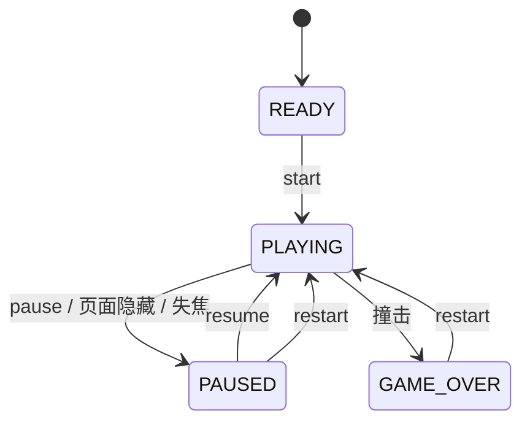

# Design — Space Fold《空间折叠》

> AI-DLC 阶段：Inception（express 流程未单列设计阶段，本设计随需求一同评审）
> 追溯：每节标注覆盖的 REQ。

## 1. 架构总览

```
            ┌───────────── main.js（组装 + 主循环）─────────────┐
            │                                                    │
 DOM 事件 → InputManager ──(axis, dragAngle, actions)──┐        │
            │                                          ▼        │
            │                 FixedStepper ──dt──▶ Game（纯逻辑）│
            │                                          │ 只读快照 │
            │                                          ▼        │
 resize  → Viewport ──尺寸──▶ Renderer（Three.js）  UIManager（DOM）
```

| 模块 | 职责 | 依赖 | REQ |
|---|---|---|---|
| `core/Game.js` | 世界状态、障碍、得分、难度、状态机驱动、事件 | 仅 systems/、GameState | FR2–FR8, FR12, FR14 |
| `core/GameState.js` | 状态枚举与合法转换表 | 无 | FR7 |
| `core/FixedStepper.js` | 固定步长累加器、delta 上限、时钟重置 | 无 | NFR1, FR12 |
| `core/InputManager.js` | 键盘 + Pointer Events 归一为 `axis`、`dragAngle`、动作 | DOM（注入的 target） | FR9, FR10, FR12 |
| `core/Renderer.js` | Three.js 场景、相机、网格池、resize | three、entities/ | FR1, FR11, FR15, NFR1 |
| `core/Viewport.js` | 视口尺寸 → 相机参数（纯函数） | 无 | FR11 |
| `systems/CollisionSystem.js` | 角度标准化、球角宽、缺口判定 | 无 | FR4 |
| `systems/SpawnSystem.js` | 障碍生成与回收（对象池） | 无 | FR3, FR14 |
| `systems/DifficultySystem.js` | 分数 → 速度/缺口/间距/旋转 | 无 | FR6, FR14 |
| `entities/Player.js` `Obstacle.js` `Tunnel.js` | 对应网格的构建与同步（渲染侧） | three | FR1, FR15 |
| `ui/UIManager.js` | 覆盖层、HUD、按钮、闪屏 | DOM | FR5, FR13, FR17 |
| `audio/Sfx.js` | WebAudio 合成音效 | Web Audio | FR16 |
| `storage/BestScore.js` | localStorage + 内存降级 | 注入的 storage | FR13 |

**解耦规则**：`Game` 不 import three、不访问 DOM；`Renderer` 只读 `Game` 状态；`UIManager` 只通过回调发出意图（start/pause/resume/restart），不直接改游戏状态；所有输入只经 `InputManager`。

## 2. 坐标与数学模型（FR2, FR4）

- 隧道轴为 Z 轴，障碍从 `SPAWN_Z = -140` 向 `+z` 移动，玩家判定平面 `PLAYER_Z = 0`，摄像机在 `z = +7`。
- 常量：轨道半径 `R = 3`，球半径 `r = 0.34`，隧道视觉半径 `3.9`，障碍管半径 `0.32`。
- 球位置：`(R cos θ, R sin θ, 0)`。

### 2.1 角度标准化

```
normalizeAngle(a)  → [0, 2π)          : ((a % 2π) + 2π) % 2π
angleDiff(a, b)    → (-π, π]          : d = normalize(a - b); d > π ? d - 2π : d
```

### 2.2 球体角宽推导

在 Z 截面内，球心距轴 R，球截面半径 r。从轴心作球截面圆的两条切线，切线与球心连线夹角 α 满足
`sin α = r / R`，故 **α = asin(r / R)**。球占据的角区间为 `[θ − α, θ + α]`。

### 2.3 通过判定

缺口是以 `gapCenter` 为中心、宽 `gapSize` 的角区间，环体占据其余 `2π − gapSize`。
障碍环端面是过轴的径向平面（TorusGeometry 的平切端面）。球不接触端面 ⇔ 球的角区间完全落在缺口内：

```
passes(θ, gapCenter, gapSize, α) = |angleDiff(θ, gapCenter)| + α ≤ gapSize / 2   （含 1e-9 浮点容差）
```

若 `gapSize/2 < α`（缺口比球还窄）则必定失败——难度系统保证最小缺口 > 2α + 余量。

### 2.4 视觉一致性

障碍网格 = `TorusGeometry(R, tube, …, arc = 2π − gapSize)`，网格绕 z 轴旋转到 `gapCenter + gapSize/2`，
使环弧从缺口上沿开始逆时针铺到缺口下沿。同一 `gapSize` 既喂给几何体又喂给判定。几何体按 `gapSize` 量化到 0.01 rad
缓存复用，判定使用量化后的同一值（生成时即量化），保证完全一致。

### 2.5 跨越检测与防漏判

- 每个模拟步：`prevZ = z; z += speed·dt`；若 `!checked && prevZ < PLAYER_Z && z ≥ PLAYER_Z` → 判定，`checked = true`。
- 判定依据"跨越"而非"距离阈值"，因此任意步长都不会漏判；固定步长 1/120 s，单帧最多推进 0.1 s（12 步），后台返回不会一次推进数秒。
- 旋转障碍在每步先更新 `gapCenter += spin·dt`，再做跨越判定，渲染时直接读取同一 `gapCenter`。
- 已知简化：只在障碍中心平面判定（球与环在 z 向的厚度窗口约 0.66 单位，以最低速 14 u/s 计约 47 ms），见 verification.md 已知问题。

## 3. 状态机（FR7, FR8, FR12）



文字版：READY →(start) PLAYING；PLAYING →(pause) PAUSED；PAUSED →(resume) PLAYING；PLAYING →(hit) GAME_OVER；
GAME_OVER →(restart) PLAYING；PAUSED →(restart) PLAYING。其他转换一律拒绝并返回 false。

- `restart()`：先 `reset()`（得分、θ、障碍池全部回收、生成器距离、难度、旋转计时、扭曲相位），再进入 PLAYING，并由 main.js 调用 `input.reset()`。
- 只有 PLAYING 时 `Game.update(dt)` 推进世界；其他状态只做纯视觉（隧道缓慢漂移由 Renderer 自己处理，不改世界）。

## 4. 主循环与时间（NFR1, FR12）

```
renderer.setAnimationLoop(t => {
  realDt = stepper.frame(t)                // 夹到 ≤ 0.1 s；时钟被 reset 后第一帧为 0
  steps  = stepper.consume()               // 固定 1/120 s 步数
  for each step: game.update(STEP, input.sample(STEP))
  renderer.render(game, alpha)             // 只读
  ui.sync(game)                            // 只在值变化时写 DOM
})
visibilitychange(hidden) → game.pause(); stepper.reset()
```

## 5. 跨端输入（FR9, FR10, FR12）

- 只监听 **Pointer Events**（`pointerdown/move/up/cancel` + `lostpointercapture`），鼠标与触摸统一；不监听 `touch*` / `mouse*`，因此不存在"触摸后模拟鼠标事件"的重复处理。
- 记录首个按下的 `pointerId`，其他指针忽略；`setPointerCapture` 保证移出画布仍能跟踪。
- 位移按 **相对增量** 换算角度：`Δθ = Δx / min(视口宽, 视口高) × DRAG_GAIN`（`DRAG_GAIN = 4.2 rad`）。用短边归一使横竖屏手感一致；转屏只改变后续增量的换算，不会改变当前 θ，因此不会跳变。
- 键盘：A/D、←/→ 形成 `axis ∈ {-1,0,1}`，角速度 `3.4 rad/s`；空格 = primary 动作；P/Esc = pause 动作。
- 清理：`pointercancel`、`lostpointercapture`、`window.blur`、`visibilitychange(hidden)` → `reset()` 清空按键集合、拖动指针与累计增量。
- 画布 `touch-action: none`，阻止浏览器滚动/缩放抢占手势。

### 控制方向一致性（ADR-1）

- **背景**：球在圆周上半部时，"向右拖 θ 增大"在屏幕上表现为球向左，方向反转令人困惑。
- **决策**：摄像机绕 z 轴滚转跟随 θ（`roll = θ + π/2`，平滑插值），球始终在屏幕底部；"向右拖/按 D = 球在屏幕上向右"恒成立。
- **后果**：隧道看起来在旋转，天然产生空间扭曲感；高分阶段再叠加 ±0.12 rad 的正弦摆动作为提示性的扭曲，不改变操作映射。
- **被否决方案**：(a) 固定摄像机——上半圆控制反转；(b) 按球所在半圆动态翻转输入——规则隐晦，违背"不得无提示反转"。

## 6. 横竖屏与尺寸（FR11）（ADR-2）

- **背景**：转屏会触发宽高互换，最常见的错误是重建场景或把屏幕坐标映射到世界导致跳变。
- **决策**：游戏实例只在启动时创建一次。尺寸变化（`ResizeObserver` 观察容器 + `window.resize` + `orientationchange` + `visualViewport.resize`）合并到下一帧执行 `renderer.resize(w, h)`：
  `setPixelRatio(min(dpr, dprCap))`、`setSize(w, h, false)`、`camera.aspect = w/h`、竖屏时增大垂直 fov 以保证水平视角 ≥ 62°（`Viewport.computeFov`）、`updateProjectionMatrix()`。世界常量（R、PLAYER_Z、速度）从不读取视口。
- **后果**：竖屏能看到完整隧道截面；转屏时世界状态逐字节不变（T6 验证）。
- **被否决方案**：(a) 转屏 reload——丢进度；(b) 按宽度缩放世界——改变物理、导致碰撞变化；(c) 锁定方向——违反约束。
- UI：全屏 `100dvh`（回退 `100vh`），覆盖层与 HUD 使用 `env(safe-area-inset-*)` 内边距，`clamp()` 字号；横屏矮屏时用 `@media (max-height: 480px)` 压缩面板。

## 7. 难度（FR6, FR14）

| 参数 | 公式（s = 得分） | 范围 |
|---|---|---|
| 速度 | `14 + 0.9·s` | ≤ 34 u/s |
| 缺口 | `1.70 − 0.035·s` | ≥ 0.80 rad（> 2α + 0.5） |
| 间距 | `20 − 0.35·s` | ≥ 11 u |
| 旋转障碍概率 | s ≥ 8 时 `min(0.6, 0.05·(s−6))` | 角速度 0.5–1.2 rad/s，方向随机 |
| 扭曲阶段 | s ≥ 15 | 摄像机摆动 + 隧道变色 |

新障碍 gapCenter 相对上一道障碍的偏移上限 `maxShift = min(π, 0.8·ω·(spacing/speed) + (gapSize/2 − α))`（ω = 键盘角速度 3.4 rad/s），
保证只用键盘也一定来得及对准（旋转障碍额外扣除旋转带来的偏移）。

## 8. 渲染与性能（FR1, FR15, NFR1）

- 材质：`MeshBasicMaterial` / `LineBasicMaterial` / `PointsMaterial`（加色混合），不使用灯光计算重的材质；无阴影、无后处理。
- 隧道：一个 `LineSegments`（24 个环 × 48 段 + 16 条纵线），通过整体 z 偏移 `distance % spacing` 循环滚动，零分配。
- 障碍：对象池最多 12 个，几何体按 gapSize 量化缓存；材质 4 色共享。
- 能量球：核心球 + 加色外发光球；尾迹 = 14 个点的 `Points`，复用位置数组。
- 粒子：单个 `Points`，容量 80，环形缓冲复用。
- DPR：`min(devicePixelRatio, 1.5)`；平均帧时间 > 22 ms 持续 2 s 自动降为 1.0（只降一次）。

## 9. 测试策略（NFR3）

Vitest，Node 环境。逻辑模块纯 JS，直接单测；`Renderer.resize` 通过注入 stub WebGLRenderer 在 Node 测试（three 的相机/场景在 Node 可用）；`InputManager` 用 Node 原生 `EventTarget` 派发合成事件。测试清单见 requirements.md §5 与 units.md。

## 10. 安全与合规

无后端、无用户数据上传；仅 localStorage 存一个整数最高分；无第三方运行时请求（three 打包进产物）。
