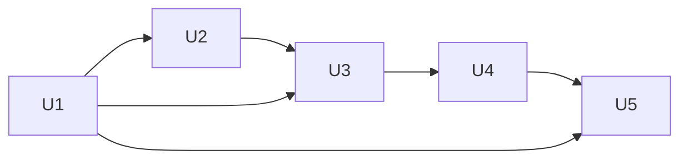

# Units & Bolts — Space Fold《空间折叠》

> AI-DLC 阶段：Inception。最小交付单元（Unit）→ 实施批次（Bolt）。

## 1. 交付单元

| Unit | 名称 | 内容 | 优先级 | 依赖 | REQ |
|---|---|---|---|---|---|
| U1 | 核心逻辑 | `CollisionSystem`、`GameState`、`DifficultySystem`、`SpawnSystem`、`Game`、`FixedStepper` | P0 | — | FR2–FR8, FR12, FR14 |
| U2 | 3D 渲染 | `Renderer`、`Tunnel`、`Player`、`Obstacle`、`Viewport` | P0 | U1 | FR1, FR11 |
| U3 | 输入与适配 | `InputManager`、resize 管线、visibility/blur 暂停、CSS safe-area | P0 | U1, U2 | FR9–FR12 |
| U4 | UI 与反馈 | `UIManager`、HUD、覆盖层、闪屏、粒子、尾迹、扭曲、`Sfx`、`BestScore`、教程 | P1（覆盖层/重开为 P0） | U1–U3 | FR5, FR13, FR15–FR17 |
| U5 | 验证与交付 | Vitest 测试、build、README、verification、progress | P0 | 全部 | NFR3, NFR4 |

文字版：U1 → U2 → U3 → U4 → U5；U3 与 U5 也直接依赖 U1。

## 2. Bolt 计划

| Bolt | 目标 | 包含 Unit | 完成定义（DoD） |
|---|---|---|---|
| Bolt 1 | 最小可玩 3D 核心循环 | U1（碰撞/状态/生成/固定步长）+ U2 基础 | 隧道、球、固定缺口障碍可见；键盘可移动；撞击→GAME_OVER；空格重开；`npm run test` 中碰撞测试通过；`npm run build` 通过 |
| Bolt 2 | 完整机制与难度 | U1 难度 + 旋转障碍 | 难度单调递增有上下限；旋转障碍复用同一判定；计分一次；重开完全重置；测试 T4、T5、T9、T10 通过 |
| Bolt 3 | 统一输入与屏幕适配 | U3 | Pointer 拖动 + 键盘统一；cancel/blur 清空；resize 只改渲染；隐藏自动暂停无时间跳跃；测试 T6、T7、T8 通过 |
| Bolt 4 | 反馈、UI、性能、测试 | U4 + U5 | READY/PAUSED/GAME_OVER 覆盖层、教程、最高分降级、音效、粒子/尾迹/闪屏/扭曲、DPR 降级；全部测试 + build 通过；浏览器实测记录 |

## 3. 需求 → 任务 → 测试追溯

| REQ | Unit / 文件 | Bolt | 测试 |
|---|---|---|---|
| FR1 | U2 `Renderer`, `entities/*` | 1 | 浏览器手动（AC12） |
| FR2 | U1 `Game.playerPosition` | 1 | T1–T3 间接；`game.test` 位置断言 |
| FR3 | U1 `SpawnSystem` | 1 | T4、T5 |
| FR4 | U1 `CollisionSystem` | 1 | T1、T2、T3 |
| FR5 | U1 `Game` + U4 HUD | 1/4 | T4 |
| FR6 | U1 `DifficultySystem` | 2 | T10 |
| FR7 | U1 `GameState` | 1 | T9 |
| FR8 | U1 `Game.restart` | 2 | T5 |
| FR9 | U3 `InputManager` | 3 | T7 + 手动 |
| FR10 | U3 `InputManager` | 3 | T7 + 手动 |
| FR11 | U2/U3 `Renderer.resize`, `Viewport` | 3 | T6 + 手动 |
| FR12 | U1 `FixedStepper`, U3 visibility | 3 | T7、T8 |
| FR13 | U4 `BestScore` | 4 | T11 |
| FR14 | U1 `SpawnSystem`, `Game` | 2 | T10 |
| FR15 | U4 `Renderer`, `UIManager` | 4 | 浏览器手动 |
| FR16 | U4 `Sfx` | 4 | 浏览器手动 |
| FR17 | U4 `UIManager` / `index.html` | 4 | 浏览器手动 |
| NFR1 | U1 `FixedStepper`, U2 `Renderer` | 1–4 | T8 + 代码审查 + 实测 |
| NFR2 | 全部 | — | 代码审查 |
| NFR3 | U1 | 1–4 | `npm run test` |
| NFR4 | U5 | 4 | `npm run build` / dev --host |
| NFR5 | U4 CSS | 4 | 浏览器手动 |
| NFR6 | 全部 | — | 代码审查 |

测试编号：T1 缺口中心通过 · T2 边缘半径判定 · T3 跨 0/2π · T4 不重复计分 · T5 重开完全重置 ·
T6 Resize 不改世界 · T7 输入取消无残留 · T8 暂停恢复无时间跳跃 · T9 非法状态转换 · T10 难度单调/旋转同判定 · T11 存储降级。

## 4. 砍范围预案

时间不足时按序砍：FR18（P2）→ FR16 音效 → FR15 扭曲/尾迹 → FR14 旋转障碍。P0 不砍。
